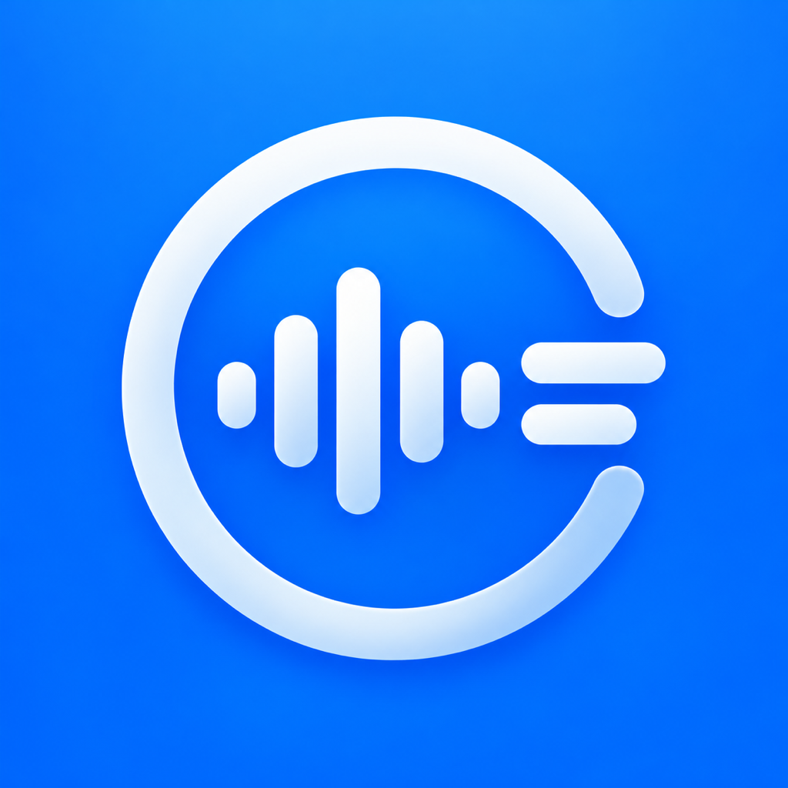

# Index Relay



[](https://github.com/yutacar/index-relay/actions/workflows/tests.yml)
[MIT](LICENSE) · [ビルド手順](docs/BUILD.md) · [確認結果](docs/PUBLICATION_VERIFICATION.md)

Index01の録音を受信して文字起こしを蓄積し、Discord・Telegramへ送る個人開発のアプリです。FlutterでiOS・Androidの画面を提供し、受信・認識・投稿は各OSのネイティブ処理を使います。

**Flutter 0.12.1 / build 34 · iOS 26以降 · Android · 日本語文字起こし · MIT**

Flutter対応完了版は **`codex/flutter`** で管理します。`main`は既存のネイティブiOS版0.9.8／36です。旧ブランチ`codex/flutter-ios-migration-rehearsal`を改名しました。iOSは実機で受信・文字起こし・ロック解除後の復帰・自動受信のオフ→オン後の再開を確認済みです。Androidはエミュレーターで認識と実サービスへの基本送信を確認しており、実機BLEは未確認です。[対応状況と管理方針](docs/FLUTTER_STATUS.md)。

非公式のアプリです。Pebble / Core Devicesの公式製品・公式サポートとは関係ありません。日常の受信は公式アプリを介さずIndex01と直接Bluetooth接続します。未設定個体の初期アクティベーション、ファームウェア更新・DFUの代替は提供しません。

## 使う版を選ぶ

| 版 | ブランチ | 確認範囲 |
| --- | --- | --- |
| ネイティブiOS 0.9.8／36 | [`main`](https://github.com/yutacar/index-relay/tree/main) | iPhoneで受信・文字起こし・投稿を確認。電池電圧の表示を追加 |
| Flutter iOS／Android 0.12.1／34 | [`codex/flutter`](https://github.com/yutacar/index-relay/tree/codex/flutter) | iOSは実機で受信・復帰を確認。Androidはエミュレーターと基本投稿を確認し、実機BLEは未確認 |

初回公開はソースのみです。App Store／Google Playやインストール用バイナリの配布は行っていません。ビルドには各SDKと、実機インストール時は利用者自身の署名設定が必要です。

```sh
git clone https://github.com/yutacar/index-relay.git
cd index-relay
# Flutter版の場合のみ選択
git switch codex/flutter
```

## できること

- リングを登録して録音を自動受信・保存。iOSはApple SpeechAnalyzer、Androidはwhisper.cppで日本語を文字起こし（Androidの実機受信は未確認）。
- ロック中・バックグラウンドの処理に対応。中断した処理は再開時に継続。
- Discord Webhook、Telegram Botのグループ・スーパーグループへ複数同時送信。
- 送信前の確認／自動送信、送り先別の接頭語、明示したDiscord IDへのメンション。
- ホームに新しい順で日時と連携状況を表示。保存件数は初期値30件で変更可能。
- 複数選択による削除、標準補正した音声の再生・WAV書き出し。

バックグラウンドの即時完了はiOSの実行枠・接続・モデル準備状況に依存します。強制終了後はアプリを開き直してください。再起動直後の初回ロック解除前は保存領域にアクセスできません。詳しくは[制約とテスト](docs/TESTING.md)。

## 開発を始める

Apple Silicon Mac、Flutter 3.47.7／Dart 3.13.5、Xcode 27.1、Python 3.9以降を使用します。iPhone実機ではiOS 26以降とIndex01が必要です。iOS受信ブリッジの生成にはJDK 17と同梱WrapperによるGradle 8.14.3を使用します。Android SDK・モデルの準備は[Flutterアプリのビルド手順](flutter_probe/README.md)を参照してください。

```sh
git switch codex/flutter
# FlutterのbinをPATHへ追加し、JAVA_HOMEは自分のJDK 17を指定
export JAVA_HOME="$(/usr/libexec/java_home -v 17)"
python3 scripts/verify-gradle-wrapper.py
bash scripts/build-receiver-framework.sh
cd flutter_probe
flutter pub get
flutter build ios --release --no-codesign --target lib/main.dart
open ios/Runner.xcworkspace
```

XcodeでRunnerスキーム、自分のTeamとBundle Identifierを設定してiPhoneへRunします。既存版を上書きする場合は、署名とBundle IDの継続性を[実機移行手順](docs/FLUTTER_IOS_MIGRATION_READY.md)で確認します。GitHub用のソースには生成済みXCFrameworkと個人の署名Teamを含めません。初回ビルド、署名、シミュレーターの制約は[ビルド手順](docs/BUILD.md)を参照してください。

## アプリの設定

1. 競合する公式アプリのBluetoothアクセスを止め、Index RelayにBluetoothを許可する。
2. 歯車 → 「リング・自動文字起こし」でリングを探索して選択し、自動処理をオンにする。
3. アプリを前面に置いて日本語モデルの準備を完了し、3〜5秒の録音で確認する。
4. 歯車 → 「送り先・送信方法」でDiscordまたはTelegramを追加する。最初は「送信前に確認する」をオンにする。

Telegramはグループ専用です。Botを追加してメッセージ送信を許可し、グループIDまたは公開スーパーグループの@ユーザー名を入力します。個別DM・チャンネル・開始リンク・候補取得は対象外です。トークンをソースやIssueへ貼らないでください。[詳しい操作手順](docs/USER_GUIDE.md)。

## テスト

```sh
python3 scripts/run-tests.py
python3 -m unittest discover -s tests/BridgeNetwork -v
```

macOSで12種類のSwiftテストを実行します。Bluetooth・音声認識モデル・実際の投稿は使いません。GitHub Actionsでも同じテストと通信検査ツールの合成テストを実行します。[実機の確認項目](docs/TESTING.md)。

## 構成とドキュメント

| 場所 | 内容 |
| --- | --- |
| `flutter_probe/` | Flutter画面、iOS接続、Androidの受信・認識・投稿 |
| `ios/IndexRelay/` | iOSの共有サービス、設定画面、音声処理、永続化、投稿 |
| `bridge/` | Haversineを利用するKotlin/Native受信ブリッジ |
| `tests/` | 状態遷移・音声・保存などのテスト |
| `scripts/` | ビルド・テスト・公開前チェック・公開用コピーの生成 |
| `ThirdPartyNotices/` | 外部ライブラリの配布情報とライセンス |

- [設計と処理の流れ](docs/ARCHITECTURE.md)
- [データとプライバシー](docs/PRIVACY.md)
- [GitHub登録手順](docs/PUBLISHING.md)
- [変更履歴](CHANGELOG.md) / [開発への参加](CONTRIBUTING.md) / [セキュリティ](SECURITY.md)

## ライセンスと参照

独自コード・ドキュメントは[MIT](LICENSE)。外部ライブラリには各ライセンスが適用され、MITへの変更を意味しません。[依存情報](ThirdPartyNotices/README.md)を参照してください。

録音受信はHaversine `2541a33` を利用します。通信・音声デコーダーすべてを独自実装した構成ではありません。[Index01公式開発情報](https://developer.repebble.com/index-01/)と[AlphaFinger](https://github.com/ddlsmurf/AlphaFinger)を仕様調査の参考にしました。AlphaFingerのコードは含めていません。

## Flutter版の開発・検証資料

[Flutterアプリのビルドと操作](flutter_probe/README.md)と[対応状況](docs/FLUTTER_STATUS.md)を入口にしてください。step 1〜7の資料は各段階の検証記録として残し、現在の対応状況と区別します。

FlutterのiOS接続・更新互換性試験は[step 4](docs/FLUTTER_STEP4.md)を参照してください。

Androidの受信・認識は[step 5](docs/FLUTTER_STEP5.md)、送り先設定・投稿処理・模擬APIでの検証は[step 6](docs/FLUTTER_STEP6.md)を参照してください。実サービスへのAPI投稿は確認済みです。到着・通知などの確認範囲は実送信確認資料を参照してください。

Flutter／Android CIとproductionビルド・署名設定・同梱物の検査は[step 7](docs/FLUTTER_STEP7.md)を参照してください。

実サービスのテスト先を使った到着・通知の確認手順と、内容や資格情報を出さない記録ツールは[実送信確認](docs/FLUTTER_LIVE_DELIVERY.md)を参照してください。実APIでの受領結果と、手動確認の状況を記録しています。

AndroidのOS別検証とモデル・権限の設定案内は[互換性と初回設定](docs/FLUTTER_ANDROID_COMPATIBILITY.md)を参照してください。

送信確認画面とオフライン・切断・再起動からの検証は[送信の復旧検証](docs/FLUTTER_DELIVERY_RECOVERY.md)を参照してください。

iPhoneのFlutter版への更新前の退避・署名照合・復旧リハーサルは[実機移行の準備](docs/FLUTTER_IOS_MIGRATION_READY.md)を参照してください。実機更新は自動実行しません。 レビュー後の修正と復旧候補・実機確認の条件は[レビュー対応](docs/FLUTTER_REVIEW_FOLLOWUPS.md)にまとめています。 iOS 26.5／27.0／27.1での合成データ試験は[シミュレーター検証](docs/FLUTTER_IOS_SIMULATOR_MATRIX.md)を参照してください。
