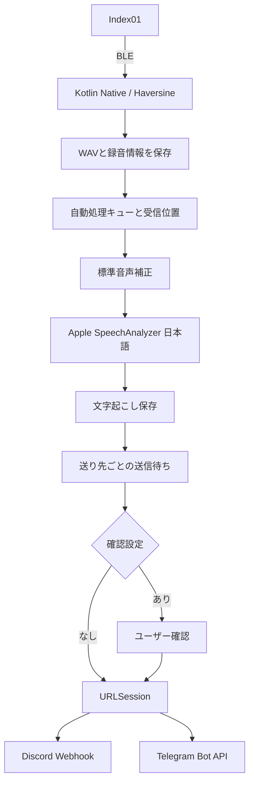

# 実装構成

この文書の図と詳細はネイティブiOS版0.9.2を基にした共有サービスの説明です。現在のFlutter版`codex/flutter`はFlutter画面からiOSのSwiftサービス／AndroidのKotlinサービスへ接続します。プラットフォームごとの構成と確認範囲は[対応状況](FLUTTER_STATUS.md)を参照してください。過去の試作設計ではなく、現在の永続化はJSONとファイルが中心です。Mac版・CloudKit同期・サーバーは実装していません。

## 責務

| コンポーネント | 責務 |
| --- | --- |
| `AutomaticRelayService` | 受信開始・復元、背景実行枠、キューと文字起こしの調整 |
| `RingReceiver.kt` | Haversineのラップ、PCMをSwiftへコピー、転送イベント、診断比較 |
| `RecordingStore` / `PCM16WAV` | WAV・メタデータ保存、読み込み、音声再生の準備 |
| `AutomaticQueue` | 処理待ち、連続保存済み範囲、再起動後の再開 |
| `AudioSignal` | DC／低域成分の抑制・音量調整。原音は変更しない |
| `SpeechFileTranscriber` / `TranscriptionController` | 日本語モデルの準備、認識、取消、結果保存 |
| `HistoryArchive` | 保存件数、削除ジャーナルと再取得抑制ID |
| `DeliveryArchive`（DeliveryModels内） | 送り先・送信ジョブ・試行・結果の永続化 |
| `DeliveryController` | 確認操作、通信開始、背景タスク、通知 |
| `DestinationKeychain` | トークン／Webhook URLの保存・取得 |
| `DeliverySessionDelegate` | レスポンス断片を集めて完了を通知。リダイレクトは拒否 |
| `DeliveryAPI` | API要求生成・登録時照合・応答分類・Telegramのグループ種別検証 |
| `DeliveryDestinationEditor` | 送り先登録。TelegramはグループIDの入力のみ |

## 保存順序と再開

音声・メタデータを永続化した後に自動処理ジョブと保存済み範囲を更新します。完了が前後しても未保存の穴を飛び越えないよう、UInt16のCollection indexの周回を含めて管理します。リングへの明示的な全消去・DFU・初回消去は要求しません。ネイティブ転送手順はHaversineに依存します。

文字起こしを保存してから送り先をスナップショット化します。ジョブは送り先ID・照合済みidentity・本文・接頭語／メンション許可を保存し、資格情報は試行時にKeychainから取得します。登録済み宛先の資格情報を変えるときも同じBot／送信対象か照合します。

受信・認識・配信は別の段階として復旧できます。アプリが落ちた後に送信中ジョブの成功を推定して自動再送することはありません。OS側タスクの有無と照合し、不明なものは結果不明にします。

## 背景実行

`bluetooth-central`による状態復元、有限の`beginBackgroundTask`、予約された`BGProcessingTask`を組み合わせます。OSの実行時刻・実行時間は保証されず、モデルの初回取得は前面で行います。録音の保存が先で、認識・配信が後で完了する場合があります。

投稿はアプリが動いている実行枠では通常のURLSessionを使い、状況によってファイルアップロード型のbackground URLSessionを使います。背景セッションへの登録が即時転送を意味するとは扱いません。通常セッションを期限切れで取り消しても投稿済みの可能性があり、曖昧な失敗を背景セッションへ無条件に二重登録しません。

## 投稿の状態

確認待ち → 送信待ち → 送信中 → 送信済み。失敗は再試行待ち・要対応・結果不明へ分けます。試行UUIDを保存して古いコールバックによる上書きを防ぎます。429はAPIのretry_afterに従い、5xxや曖昧な取消・タイムアウトは結果不明。`countOfBytesSent == 0`だけでは未投稿と断定しません。

Discordでは`wait=true`でメッセージIDを取得。メンションは`allowed_mentions.parse=[]`と明示IDの許可リスト。Telegramは`parse_mode`を付けずプレーンテキストです。

## 履歴削除

削除IDを永続化 → 対象の音声・文章・ジョブを削除 → 完了を記録、の順です。途中終了しても次回起動時に続行し、再取得でホームに復活させません。削除済みIDなどの制御情報は保持します。投稿開始済みの通信は取消を試みても、外部サービスに到着済みの内容までは取り消せません。

## 0.9.2の復旧処理

起動時の照合で結果不明にした場合も、同じ試行IDのOS完了結果は後から採用します。ユーザーが送信済み・終了・再送を選んだ後や、別の試行の結果は採用しません。明示的な承認・再送で自動再試行回数をリセットし、サーバーの待機中は待機を維持します。曖昧な失敗は引き続き結果不明です。

録音を未保存のままスキップする提案と、レート制限の適用範囲変更は採用していません。[レビュー結果](REVIEW_2026-10-20.md)を参照してください。

## Telegramの対応範囲（0.9.6）

`getMe`／`getChat`／`sendMessage`だけを使用し、group・supergroupに限定する。開始リンク・候補取得とそのセッション管理を削除。永続モデルの形式は維持し、旧DM・チャンネルの送信を起動時に停止する。未送信を取消、開始済みをunknownとして扱い、OSの復旧タスクは取消対象になる。別グループへの自動振り替えをせず、履歴と実際の成功応答を保持する。
